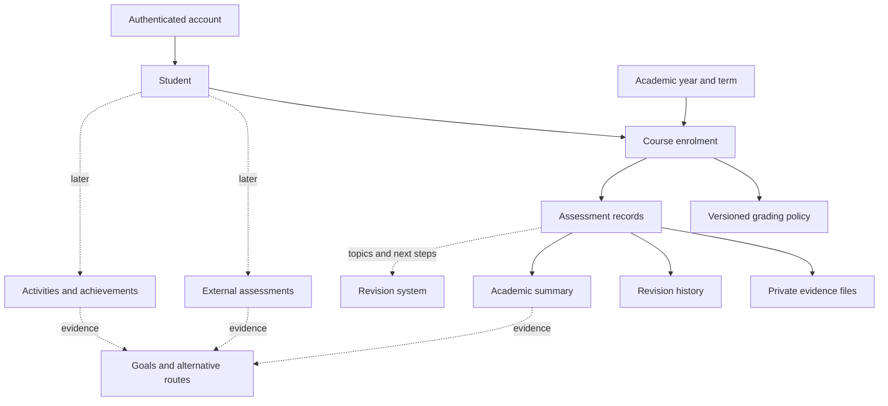

# ERP structure and release scope

Decision: 26 October 2026. Prioritise US-style courses and weighted grades; complete school academics first.

| Layer | Responsibility | This release |
|---|---|---|
| Shared foundation | Account ownership, students, terms, stable IDs, evidence, revisions | Implemented |
| Overview | Separate course summaries and follow-up items | Implemented |
| School academics | Results, policies, report-card originals, corrections, imports, attachments | Implemented |
| External assessments | Official/practice sittings, component scores, targets | Reserved |
| Activities/projects | Participation, role, time, reflection, deliverables | Reserved |
| Achievements/portfolio | Awards, certificates, original work, source activities | Reserved |
| Revision system | Topic mapping, tasks and practice results | Topic/next-step fields only |
| Goals/pathways | Aspirations, prerequisites, alternatives, reviewed revisions | Reserved |

Each module owns its record types and shares student IDs. A practice score must never overwrite a school grade. Facts, sources, observations and interpretations remain distinct.

## Screens and first-use sequence

1. Overview: course rows, record counts, unsubmitted/absent/unreviewed items and recent results. No aggregate child score.
2. Academics: course tabs, weighted result and coverage, official grade, category bars, comparable-series chart and assessment ledger.
3. Result detail: original grade, feedback, next step, evidence and revision history.
4. Settings: profiles, terms, export and separate example student.
5. Reserved pages explain future functions and clearly state they are not yet implemented.

Create student → create term → create course → check school weights → enter/import results → verify source → attach evidence → agree next step. The initial weight template is not asserted to match the school.

## Next phases

Connect the existing revision system after inspecting its actual API/topic schema. Then add external assessments, activities and portfolio. Build pathway planning after evidence collection is reliable. Shared parent/student/teacher access requires a separate permission model before expanding sharing.

A revision task should carry stable student/course/assessment/topic references and human approval. Return practice attempts to a separate record type with external IDs and idempotency keys. This is a proposed contract, not a working connector.

Pathways should preserve the child's stated interests, objective prerequisites, dated sources, alternatives and reasons for changes. Low marks trigger support and review, not automatic disqualification. ILO/Hong Kong QF mappings require separately reviewed reference tables and never confer qualifications.
